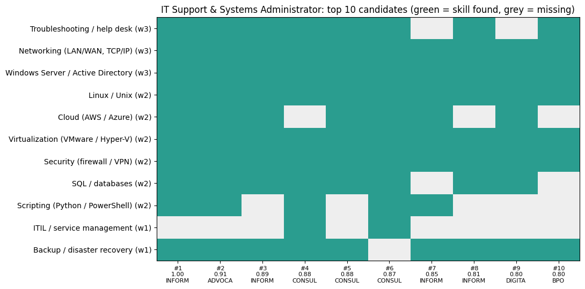
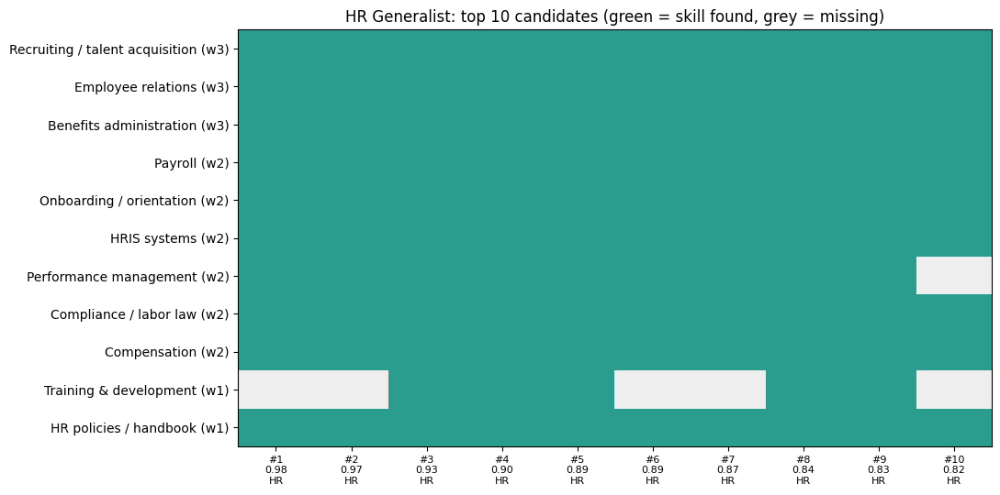
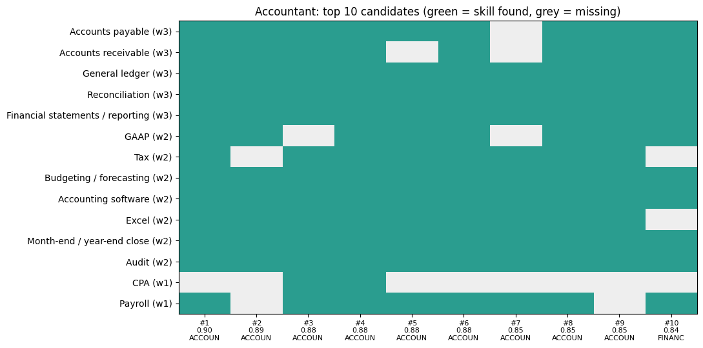
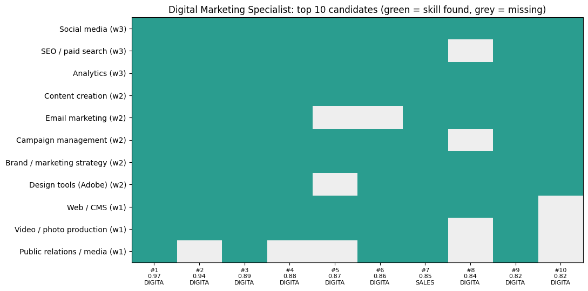

# FUTURE_ML_03: Resume / Candidate Screening System

**Machine Learning Internship, Task 3 | Future Interns**

A decision-support system that reads resume text, compares it with a job description, **ranks candidates by role fit**, explains **why** each candidate ranked where they did, and shows **which required skills are missing**.

> **Important:** this is a shortlisting aid for a human recruiter, not an automatic hiring or rejection tool. See sections 7 and 8.

---

## 1. Business problem

A hiring team can receive hundreds of resumes for one job. Reading each one is slow, inconsistent and error-prone. This system produces a ranked shortlist with a clear, readable reason for every score, so a recruiter can start with the most relevant candidates and see skill gaps at a glance.

## 2. Data

- **Resume Dataset** (Kaggle, `snehaanbhawal/resume-dataset`): about 2,480 text resumes in 24 job categories, with 100 to 120 resumes in most categories (the smallest are Agriculture 63, Automobile 36 and BPO 22).
- One resume under 50 words and 2 duplicate texts were removed.
- **Job descriptions:** the task allows custom job descriptions, so I wrote 4 roles, each matched to a category that exists in the dataset (this allows an objective check):

| Role | Matching category |
|---|---|
| IT Support & Systems Administrator | INFORMATION-TECHNOLOGY |
| HR Generalist | HR |
| Accountant | ACCOUNTANT |
| Digital Marketing Specialist | DIGITAL-MEDIA |

The raw resume data is **not** included in this repository (size, and resumes can contain personal information). Download it from Kaggle to run the notebook.

## 3. Approach

1. **Cleaning:** lowercase; remove URLs and emails; tokenize, remove stopwords and resume boilerplate (section headers, placeholders like "Company Name"), and lemmatize with NLTK. Two text versions are kept: a cleaned one for similarity, and a lightly processed one for skill matching so that terms such as `C++` or `.NET` survive.
2. **Skill extraction:** each role has a **weighted skills dictionary** (11 to 14 skills per role). Skills are matched with whole-word patterns and aliases (for example "AWS" or "Azure" both count as Cloud). Weights: **3 = must-have, 2 = important, 1 = nice-to-have**.
3. **Similarity:** TF-IDF (single words and 2-word phrases) with cosine similarity between each resume and the job description.
4. **Ranking:** every resume gets a combined score from 0 to 1.
5. **Explanation:** matched skills, missing skills and the key terms that drive the similarity score.

## 4. How resumes are scored

```
combined score = 50% x TF-IDF similarity  +  50% x weighted skill score
```

(each part is rescaled to 0 to 1 across the resume pool so they can be blended fairly)

- **TF-IDF similarity** measures how much of the job description's vocabulary the resume shares, giving more weight to distinctive words (like `reconciliation`) than to common ones (like `management`).
- **Weighted skill score** is the share of the role's total skill weight that the resume covers. A missing must-have costs three times as much as a missing nice-to-have.

The 50/50 blend was chosen before looking at the evaluation results and was not tuned on the category labels.

## 5. Why candidates rank higher, and what is missing

For every candidate the system reports matched skills, missing skills (ordered by importance) and key shared terms. For example, the top HR candidate (ID 73077810) matched 10 of 11 skills, missing only the lowest-weight "Training & development", and shared terms such as `open enrollment`, `employee handbook` and `hris` with the job description.

The top-10 comparison charts show candidates against required skills (green = found, grey = missing):

| | |
|---|---|
|  |  |
|  |  |

`ranked_candidates_top50.csv` holds the top 50 per role (resume ID, category, scores, matched and missing skills). It contains **no resume text**.

## 6. Evaluation

There are no human "good fit" labels, so I used the dataset's job category as a proxy: if we rank all resumes against the "Accountant" description, do the top results come from the ACCOUNTANT category? A random ranking would put about 4.5% target resumes in any top list.

Average over the 4 roles (higher is better):

| Resume version | Ranker | P@10 | P@20 | AUC |
|---|---|---|---|---|
| Full resume | TF-IDF only | 0.800 | 0.788 | 0.957 |
| Full resume | Skills only | 0.725 | 0.662 | 0.930 |
| Full resume | **Combined 50/50** | 0.800 | 0.750 | 0.948 |
| Headline removed | TF-IDF only | 0.800 | 0.775 | 0.955 |
| Headline removed | Skills only | 0.675 | 0.650 | 0.930 |
| Headline removed | **Combined 50/50** | 0.800 | 0.750 | 0.947 |

Combined ranker per role (headline removed):

| Role | P@10 | P@20 | AUC |
|---|---|---|---|
| HR Generalist | 1.00 | 0.95 | 0.970 |
| Accountant | 0.90 | 0.85 | 0.970 |
| Digital Marketing Specialist | 0.80 | 0.70 | 0.921 |
| IT Support & Systems Administrator | 0.50 | 0.50 | 0.928 |

**What this shows**
- The ranking is much better than random: the top 10 contains about 80% matching-category resumes, roughly 18 times the random rate.
- **It does not just read the job title.** Removing each resume's headline barely changes the results (AUC 0.948 to 0.947).
- **TF-IDF alone is slightly better at retrieval** than the combined score (AUC 0.955 vs 0.947), and the gap is small with only 4 roles. The skill score is kept because it is what makes the system explainable (matched and missing skills), not because it improves retrieval.
- **The IT result looks weak partly because the label is only a proxy.** Several top-ranked IT resumes come from neighbouring categories (Consultant, Advocate, BPO, Digital Media), and the skill charts show they do contain nearly all the required IT skills. They may well be qualified, or mislabeled. Similarly, the Accountant top list includes Finance resumes. These are not necessarily mistakes, but precision against category labels cannot tell us.

## 7. How a recruiter can use it

- Start with the top of the ranked list for a role instead of reading the whole pile.
- Read the **missing skills** to prepare interview questions, or to decide whether a gap can be trained.
- Treat borderline and unexpected candidates (for example those from neighbouring categories) as worth a human look.
- Paste a new resume text into `screen_resume()` to see its score, percentile against the pool, found skills and missing skills.

## 8. Limitations, fairness and privacy

- **Not an automatic decision-maker.** A ranking should never be the only reason to reject someone. A human should review the shortlist and also the candidates just below the cut-off.
- **Bias risk.** The system looks only at the text of skills and experience (no names, gender, age or photos are used), but resume language itself can reflect gender, background or career gaps. **No bias audit was done**, and one is needed before real use.
- **Keyword gaming.** A short resume stuffed with the right keywords scores highly (shown in the demo). Real systems need checks for depth and evidence of the claimed skills.
- **Proxy evaluation.** Category labels are not ground truth for job fit (see section 6), and only 4 roles were tested.
- **Hand-built skill dictionaries.** They cover only these 4 roles and English text, and some skills are generic and appear across many categories (for example Excel, budgeting, compliance and SQL appear in many non-target resumes). New roles need new dictionaries.
- **Weights are judgment calls.** The 3/2/1 skill weights and the 50/50 blend are choices by the author. The notebook shows how results change with the blend weight.
- **Privacy.** Outputs and saved files show resume IDs and scores, never resume text. Raw resumes are excluded from this repo.

## 9. How to run

1. Download the Resume Dataset from Kaggle and open `FUTURE_ML_03.ipynb` in Google Colab.
2. Upload `Resume.csv` when asked and run the cells top to bottom.

Libraries: `pandas`, `numpy`, `matplotlib`, `scikit-learn`, `nltk`.

## 10. Repository contents

| File | Description |
|---|---|
| `FUTURE_ML_03.ipynb` | Full notebook (cleaning, skills, ranking, evaluation, explanations, demo) |
| `ranked_candidates_top50.csv` | Top 50 candidates per role with scores, matched and missing skills (IDs only) |
| `candidates_*.png` | Top-10 candidate vs skill comparison charts, one per role |
| `README.md` | This file |

---

**Author:** [Your Name] | Machine Learning Intern, Future Interns | [LinkedIn profile link]
