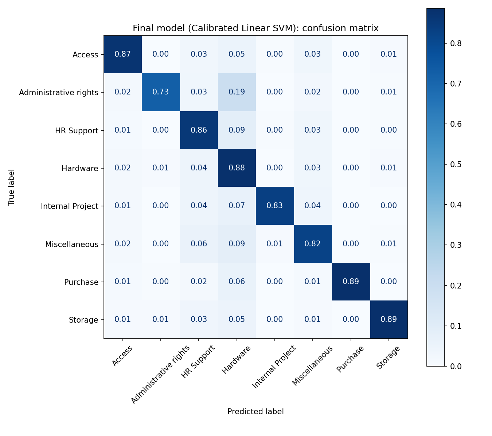

# FUTURE_ML_02: Support Ticket Classification & Prioritization

**Machine Learning Internship, Task 2 | Future Interns**

A system that reads a raw IT support ticket and returns:
1. its **category** (8 classes),
2. a **confidence score**,
3. a **priority** (High / Medium / Low) with a plain-English reason,
4. a **"needs human review" flag** for tickets it is unsure about.

---

## 1. Business problem

Support teams receive hundreds or thousands of tickets a day. Tickets that are routed to the wrong team or buried in the queue delay urgent issues and waste agents' time on sorting instead of solving. This project automates the sorting step and makes the logic explainable to a support manager.

## 2. Dataset

- **IT Service Ticket Classification Dataset** (Kaggle, `adisongoh/it-service-ticket-classification-dataset`)
- 47,837 tickets, 2 columns: `Document` (ticket text) and `Topic_group` (category)
- No missing values and no duplicate rows. The text is already lowercase with punctuation removed.
- 8 categories, imbalanced: Hardware (13,617), HR Support (10,915), Access (7,125), Miscellaneous (7,060), Storage (2,777), Purchase (2,464), Internal Project (2,119), Administrative rights (1,760)
- The dataset has **no priority labels**, so priority is decided by transparent rules (section 5).

## 3. Approach

1. **Text cleaning (NLTK):** lowercase, remove URLs and emails, tokenize, remove English stopwords plus noise words (greetings, weekday and month names), and lemmatize. 2 tickets became empty and were dropped.
2. **Data-quality fix:** after cleaning, 916 tickets were duplicates and 14 texts appeared under more than one category. Ambiguous texts were removed and one copy of each duplicate kept, so identical tickets cannot appear in both train and test and inflate the scores.
3. **Split:** stratified 80/20 train/test split (9,381 test tickets).
4. **Features:** TF-IDF on single words and 2-word phrases (fit on the training set only).
5. **Models compared:** Logistic Regression, Linear SVM, Complement Naive Bayes, all with the same features and test set.
6. **Final model:** Linear SVM wrapped in probability calibration, which gives a confidence score for each prediction.
7. **Priority engine:** rule-based, applied to the raw ticket text.

## 4. Results

### Model comparison (test set)

| Model | Accuracy | Macro F1 |
|---|---|---|
| **Linear SVM** | **0.857** | **0.858** |
| Logistic Regression | 0.845 | 0.847 |
| Complement Naive Bayes | 0.815 | 0.813 |

Linear SVM is better in every category, though by a small margin over Logistic Regression (about 1 point). The final model is the calibrated version of the Linear SVM.

### Final model: calibrated Linear SVM

**Accuracy 0.858 | Macro F1 0.862**

| Category | Precision | Recall | F1 | Test tickets |
|---|---|---|---|---|
| Access | 0.911 | 0.871 | 0.890 | 1,409 |
| Administrative rights | 0.861 | 0.726 | 0.788 | 350 |
| HR Support | 0.860 | 0.856 | 0.858 | 2,115 |
| Hardware | 0.817 | 0.882 | 0.849 | 2,695 |
| Internal Project | 0.902 | 0.833 | 0.866 | 420 |
| Miscellaneous | 0.827 | 0.822 | 0.824 | 1,395 |
| Purchase | 0.961 | 0.887 | 0.923 | 450 |
| Storage | 0.901 | 0.887 | 0.894 | 547 |

Because the classes are imbalanced, **macro-F1 and per-class recall** matter more than accuracy alone. Class weights were balanced during training.



### Error analysis

- **Weakest class: Administrative rights.** Recall is 0.73, and about 19% of these tickets are predicted as Hardware (both involve software and device issues).
- **Misclassified tickets are mostly genuinely ambiguous.** Examples contain almost no category-specific words (for instance only "severity", "value", "picture"). These are the tickets where a human should look.
- **Explainable:** the strongest words per category match intuition: Storage (`folder`, `mailbox`, `file`), Purchase (`po`, `purchase`, `item`), Hardware (`laptop`, `monitor`, `cable`), Access (`password`, `license`, `account`).

### Confidence threshold (human-in-the-loop)

| Min confidence | Auto-routed | Accuracy on auto-routed | Sent to human review |
|---|---|---|---|
| 0.5 | 93.9% | 88.3% | 6.1% |
| **0.6 (used)** | **84.7%** | **91.5%** | **15.3%** |
| 0.7 | 75.9% | 94.4% | 24.1% |
| 0.8 | 64.9% | 96.6% | 35.1% |

At the 0.6 threshold, about 85% of tickets are routed automatically at 91.5% accuracy (up from 85.8% overall), and the least certain 15% go to an agent. A team that cares more about avoiding mistakes than saving time can raise the threshold.

## 5. How priority is decided

The dataset has no priority labels, so priority is assigned by **transparent, editable rules** applied to the raw ticket text and the predicted category. This is a business policy, **not a trained model**, so there is no accuracy score for it.

| Priority | Rule |
|---|---|
| **High** | Urgent wording (urgent, asap, immediately, critical, emergency, outage, system/server down, data loss, security breach, virus/malware, P1), **or** a blocking phrase (cannot, not working, unable to, failed, crashed, locked out, no access) in a high-impact category: Access, Hardware, Administrative rights, Storage |
| **Medium** | Default; also blocking phrases in lower-impact categories (for example a timecard that cannot be submitted) |
| **Low** | Clearly non-urgent wording ("how to", "how do", "wondering", "whenever", "suggestion", "no rush"), or a routine Purchase request with no urgency |

A blocking phrase can never produce Low. The rules were refined after reviewing sample tickets: the generic word "information" was removed because it caused wrongly low priority.

**Priority distribution on the test set:** Medium 81.1%, High 13.8%, Low 5.1%. High is most common for Administrative rights (27%) and Hardware (26%), and Purchase tickets are almost all Low (98%).

## 6. Demo

```python
predict_ticket("URGENT: my laptop screen is black and I cannot work, meeting in 10 minutes")
# {'category': 'Hardware', 'confidence': 0.97, 'priority': 'High',
#  'priority_reason': "urgent wording: 'urgent'", 'needs_human_review': False}

predict_ticket("I cannot log in, my password reset link is not working")
# {'category': 'Access', 'confidence': 0.87, 'priority': 'High', ...}

predict_ticket("How do I increase my mailbox storage limit when possible")
# {'category': 'Storage', 'confidence': 0.99, 'priority': 'Low', ...}

predict_ticket("severity appears value highlighted picture removed analyst")
# {'category': 'Miscellaneous', 'confidence': 0.49, 'priority': 'Medium',
#  'needs_human_review': True}
```

## 7. How this helps support operations

- **Faster response:** about 85% of tickets reach the right team automatically, which removes manual sorting.
- **Urgent issues surface first:** about 14% of tickets are flagged High with a visible reason, so agents can see why a ticket is urgent and challenge the rule if needed.
- **Fewer silent mistakes:** uncertain tickets are flagged for review instead of being confidently misrouted.
- **Staffing insight:** Hardware and HR Support make up over half of all tickets, which shows where support capacity is needed.
- **Easy to tune:** the confidence threshold, the keyword lists and the high-impact categories are all simple settings a support manager can adjust.

## 8. Limitations

- Priority rules are a **heuristic with no ground truth**, so they should be validated against real agent decisions before relying on them.
- Keyword rules can fire on words in signatures or quoted text, and they only work for English.
- Administrative rights is the weakest category (recall 0.73).
- The dataset text is anonymized and noisy (repeated phrases, timestamps), and it comes from one organization, so the model may need retraining for a different company's tickets.
- The Low class is deliberately conservative: it is mostly routine purchase requests plus explicit non-urgent wording.

## 9. How to run

1. Download the dataset from Kaggle.
2. Open `FUTURE_ML_02.ipynb` in Google Colab and upload the CSV when asked.
3. Run all cells top to bottom.

Libraries: `pandas`, `numpy`, `matplotlib`, `scikit-learn`, `nltk`, `joblib`.

## 10. Repository contents

| File | Description |
|---|---|
| `FUTURE_ML_02.ipynb` | Full notebook (cleaning, models, evaluation, priority engine, demo) |
| `confusion_matrix.png` | Confusion matrix of the final model |
| `ticket_predictions_test.csv` | Test-set predictions with confidence, priority, reason and review flag |
| `README.md` | This file |

---

**Author:** [Your Name] | Machine Learning Intern, Future Interns | [LinkedIn profile link]
